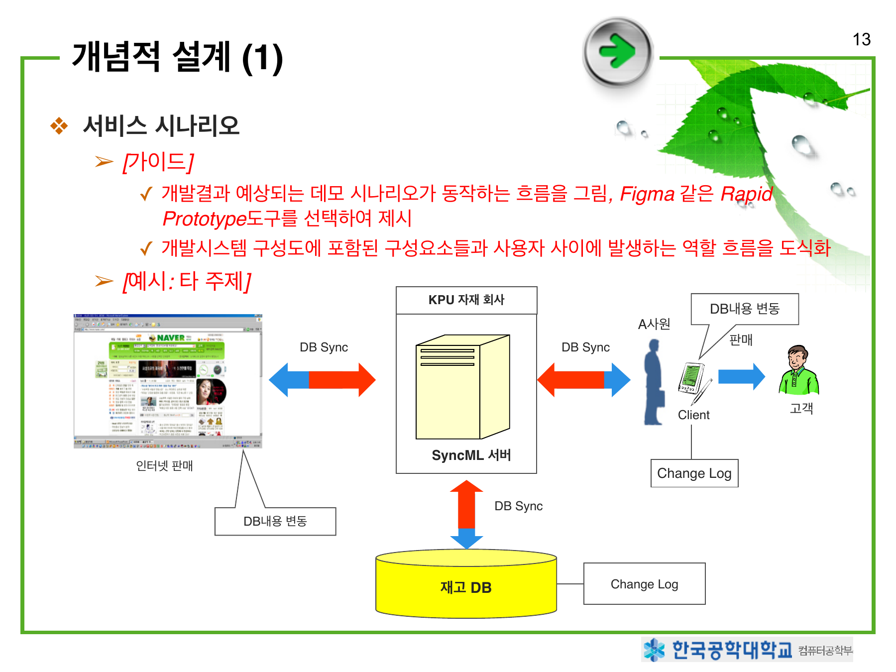
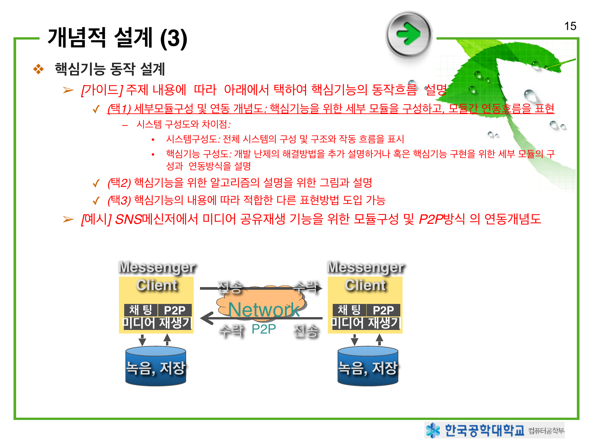
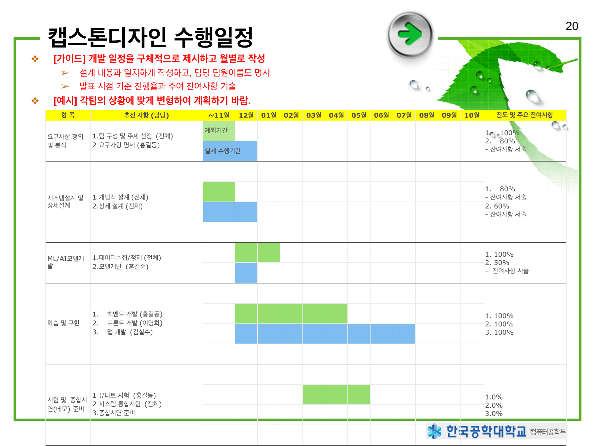

# AI융합대학 컴퓨터공학부 캡스톤디자인 제안서

> 원문은 작성 안내와 예시가 포함된 27쪽 양식입니다. 안내 문구는 원문 내용으로 보존했습니다. 페이지별 구성을 유지하고 표는 마크다운으로 옮겼으며, 도식은 원본 이미지로 함께 제공합니다. 예시의 기술명·수치·주소·미기입 항목은 원문 기준입니다. 과거 서비스 주소와 미완성 저장소 주소는 클릭 가능한 링크 대신 코드로 표시했습니다.

---

## 1. 표지

**AI융합대학 컴퓨터공학부 캡스톤디자인 제안서**

**한글제목**  
(영어제목)

20OO년 11월 O일

**지도교수:** (서명)

**##세션 · ##팀**

| 구분 | 학번 | 이름 |
| --- | --- | --- |
| 팀장 | 학번 | 이름 |
| 팀원 | 학번 | 이름 |
| 팀원 | 학번 | 이름 |
| 팀원 | 학번 | 이름 |

> [가이드] 표지는 지도교수 서명 받은 후 스캔해서 첨부

---

## 2. 자료작성 및 발표 참고사항

### PPT 발표 분량

- 기획발표시(15~20p), 데모, 최종 데모 발표(20~30p) 작성
- 지엽적인 내용이나 질문 시에 답변할 보완자료는 Appendix에 배치

| 발표 구분 | 자문 및 평가 관점 | 중점 발표 사항 |
| --- | --- | --- |
| 기획 발표 (지도교수님 진행) | 컴공 졸업작품으로 적합한 주제인가? 1. 개발 필요성 2. 개발 난이도 3. 개발분량 4. 개발방향의 적합성 5. 상세 설계의 적합성 6. 개발 성공가능성 7. 개발 진도 8. 기타 (발표능력, 발표자료준비, 팀웍 등) | 1 → (PPT) 연구동기, 주제개요 2~3 → (PPT) 주제 개요, 개발 목표 4 → (PPT) 개발 목표, 개발 전략, 개념적 설계 5 → (PPT) 개념적 설계, 상세설계 (+필요시: 변경된 주제범위~개발전략) 6 → (PPT) 핵심 기능 데모 7 → (PPT) 수행 일정 (일정에 맞추기 위한 전략과 보정 내용 설명) |
| 데모 발표 (27.4) | 개발 결과 확인 1. 개발 결과의 기술적 완성도 2. 개발 진도 3. 기타 (시연능력, 지적사항 반영, 팀웍 등) | 1 → 데모 2 → (PPT) 수행 일정 및 개발 현황 |
| 최종 데모 발표 (27.6) | 최종 완성도 확인 및 공학대전 전시 후보작 선정 1. 개발 결과의 종합적 완성도 2. 데모의 구성 및 진행: 데모를 위한 샘플자료 및 시나리오 구성에 유의 3. 기타 (지적사항 반영, 팀웍 등) | 1~2 → 데모 시연 동영상, 판넬 파일 3 → 개발 현황, 지적사항 반영 |

---

## 3. 참고: 발표 시 준비사항

### 세션 발표 준비: 데모 발표

- 데모 발표 일정: 4월 중
- 겨울 방학에 팀원들끼리 준비 요망

### 데모 발표 주요 포함사항

- 상세설계: Appendix C.를 참고
- 핵심(기본)기능 데모
  - 선정한 주제의 개발 성공여부를 결정 짖는 핵심 기능(모델, 알고리즘 등)을 구현하여 데모
  - UX flow와 더불어 핵심기능을 구현
    - 단, 핵심기능이 UX에 붙지 못할 수도 있음.

---

## 4. 차례

1. 주제 배경
2. 관련 연구 및 연구동기
3. 주제 개요
4. 개발전략 및 개발목표
5. 요구사항 및 개념적 설계
6. 개발 도구 및 산출물
7. 업무문답 및 수행일정
8. 참고문헌
9. 상세 설계

---

## 5. 주제 배경

[참고] 일부 예시는 “생성형AI를 이용한 수학튜터서비스”로 가정하여 제시함.

### 최근의 관련 기술 동향 [참고문헌 번호추가]

- [가이드] 선정한 주제를 포괄하는 넓은 기술분야의 동향을 간단히 서술
- [예] 최근 들어, 생성형 AI기술은 초기의 텍스트 생생기술을 이용한 영어튜터서비스를 넘어, 수학튜터, 과학튜터 등에 사용할 수 있는 논리적 추론기술이 개발되어 고도화되고 있다.

### 최근의 관련 산업(시장)의 동향 [참고문헌 번호추가]

- [가이드]
  - 국내/국외 관련 시장의 연도별 추이그래프 등을 이용하여 설명,
  - 신규 서비스라 시장집계가 없을 경우, 관련 사례의 매출 등으로 대체 가능
- [예]
  - 수학튜터서비스 시장의그래프와 설명
  - (AI)튜터서비스 시장의 그래프와 설명

**[평가 관점]**

- 최근의 기술/산업적 동향관점에서 적절한 주제분야를 선택했는가?

---

## 6. 관련 연구 및 사례

주제와 관련하여 어떻게 기술개발, 연구, 혹은 사례(응용, 서비스, 오픈소스 등) 3~5개 소개. 개발할 주제와 관련 있는 기술, 연구, 혹은 사례를 3~5개의 특징을 간단히 서술.

- **[가이드]** 개별 사례를 각각 설명하거나 표로 정리하여 설명
- **[주의]** 선정주제를 설명하는데 필요한 배경지식이 아니라 유사 혹은 경쟁 연구/기술/사례를 설명
- **[예]** 표로 설명한 사례

| 메신저 이름 | 내용 |
| --- | --- |
| msn | 현재 MSN은 디지털 콘텐츠 전문기업 디지털프리즘(`www.digitalprism.co.kr`, 원문 당시 주소)과 제휴를 맺고 지난해 10월부터 MSN 메신저 엔터테인먼트 탭(Tab)과 MSN 음악 서비스를 제공하고 있다. 이 서비스는 월정액의 요금제를 적용하는 유료 서비스이며, 요금은 한 달에 3000원. ‘음악채널’을 통해 곡당 다운로드 비용으로 800원을 받고 있음. |
| nate on | 친구들과 더불어 공개한 뮤직을 공유하는 쥬크박스 서비스. 이전의 대화 BGM 서비스에서 음악듣기가 한층 수월해 졌음. 쥬크박스 플레이어를 통해 내 음악은 물론, 친구의 음악을 손쉽게 들을 수 있음. 네이트온 쥬크박스를 통해 듣고자 하는 뮤직은 웹페이지에서 구입(`http://nateonmusic.nate.com`, 원문 당시 주소) 또는 선물을 할 수 있음. |
| Audio Messenger | 기존 메신저들은 웹 서버에서 음악을 구입하거나, 서버에서 직접 전송하는 기능. **A.M 특징:** 웹 서버가 아닌 P2P 방식을 채택하여 미디어 파일을 전송. 비용을 절감하면서 음악을 대화상대와 같이 들을 수 있음. |

---

## 7. 연구(주제선정) 동기

### 관련 연구/기술/사례의 장단점 분석

- [가이드] 연구동기를 유도할 수 있는 기존 내용을 표나 그래프 등으로 제시하고 연구동기를 유도할 수 있는 단점중심 분석셜과기술
- [예]
  - 장단범 비교 분석표를 제시.
  - 기존 튜터시스템은 텍스트중심의 영어, 국어과목만 가능하고, 수학, 과학 과목을 위한 튜터시스템이 없거나 기능이 매우 부족하다.

### 연구 동기

- [가이드] 분석한 단점(성능개선, 적용범위 확대, 신기능 추가 등)을 개선하는 시스템을 제안하고, 개선전략 1~3개를 직관적으로 제시
  - 조사된 기술의 문제점을 기술하고 개선하기 위한 방안을 작성
  - 필요성을 제기하는데 논리를 강화시킬 것
  - 사회적 필요성을 제시할 수도 있음 예) 장애인, 노약자, 경제적 약자 등을 위한 서비스 등

- [예]
  - 수식까지 포함된 내용를 처리할 수 있는 수학추론모델을 생성형AI와 결합하여 AI수학튜터시스템을 제안하고자 한다.

**[평가 관점]**

- 기술적, 시장수요적, 교육적 관점에서 적절한 주제인가?

---

## 8. 주제 개요 (1)

(예) AI수학튜터시스템의 개요(1)

### 제안주제의 개요 (예: AI수학튜터시스템의 개요)

- [가이드]
  - 작품의 전반적인 개요에 대하여 간략하게 작성하고, 그림, 개략도 등을 이용하여 직관적인 전달이 가능하도록 기술
    - 단일 앱만 개발 및 단순한 인공지능 알고리즘만 이용은 불가하고 반드시 앱은 서버와 연동이 필요, 인공지능도 추가적인 데이터분석과 응용 서비스 제공해야 함.
    - 게임은 게임 시나리오, 캐릭터디자인 첨부가 필수
  - 기업체와 연계할 경우 기업에서 수행 내용 등 포함해서 작성하되, 기업에서 개발하는 내용은 표시

---

## 9. 주제 개요 (1) - 특징 및 기대효과

(예) AI수학튜터시스템의 개요(1)

### 제안주제의 특징(혹은 주요기능) (예: AI수학튜터시스템의 특징)

- [가이드] 연구동기와 제안주제의 개요의 내용을 달성하기 위한 주요 특징과 주요기능 설명
- [예] 특징
  - 수학논리적추론모델(ABC)를 llama 와 결합하여 수학논리모델을 구성
  - 개인 맞춤형 수학튜터 서비스 제공
  - 학생의 수학능력 분석능력: 결과 제공
  - 수학문제 출제 기능: 문제, 해답, 해설을 함께 제공함.
  - 학생의 답에 기반한 보완학습이 필요한 주제와 학습순서를 제시

### 기대효과

- [가이드] 주제를 통해서 얻고자 하는지 기대효과 서술
- [예] 비싼 수학과외를 대체할 수 있는 저렴한 개인 맞춤형 수학튜터 서비스를 제공하여 고등학생들의 학습기회를 확대하고자 함.

---

## 10. 개발 전략

### 개발 전략

- [가이드] 핵심기술, 데이터, 서비스플랫폼 등 개발 관련 주요전략 제시
- [예]
  - (핵심기술) AI수학기능:공개된 ABC모델을 llama와 결합한 생성형 모델 구성
  - (데이터 확보) 고등학교 수학참고서 3종의 방정식 주제만을 스캔하여, 학습데이터로 활용
  - (학습서버): 구글 collab 혹은 AWS 서버 등을 검토하여 선택 활용
  - (서비스 플랫폼) 반응형 웹으로 PC와 폰에서 모두 구동 가능
  - (AI오류해결) 휴먼튜터 개입 기능을 포함

---

## 11. 개발 목표

### 성능 목표

- [가이드] 성능에 대한 구체적인 정량적 지표를 자체적으로 설정하여 작성
  - 성능평가를 위해서 시험구성도, 시험방법 제시 필수
  - 최종 완성되었을 때 성능, 사양, 기능, SW품질평가 항목 등을 가능한 정량적으로 나타내어 작성
- [예시]
  - 해답의 정확도: 99%
    - 학습하지 않은 다른 참고서의 방정식 문제 100건을 추출하여 테스트
  - 응답 속도: 1분 이내
- [예시: 타 주제]
  - 1. 드론 비행 거리 및 속도 : 50m를 10초이내 비행
    - 시험방법 : 실내에서 시험 비행을 10회 이상 실시하여 평균값으로 측정
  - 2. 플랫폼 웹페이지 및 SW 반응속도 : 2초 이내
  - 3. 동시접속자수 : 5분동안 최대 1000명

### 기타 목표 (선택)

- [가이드] 성능 이외에 필요한 서비스 범위, 데이터, 콘텐츠 등의 목표 제시,
- [예시]
  - 학습데이터: 100만건 이상
  - 서비스 범위: 고등학교 방정식
  - 문제의 수: 생성 문제의 수 100건 이상

---

## 12. 개발 요구사항

### 요구사항

- [가이드] 다음 관점 중 적합한 것을 취사 선택하여 서술 (복수개 가능)
  - 사용자(관리자, 중간사용자, 운영자, 최종사용자 등)의 관점에 따른 기능 구성 관점
  - 기능 특징기준 분류관점
  - UX flow 관점
  - 기타 관점

---

## 13. 개념적 설계 (1)

### 서비스 시나리오

- [가이드]
  - 개발결과 예상되는 데모 시나리오가 동작하는 흐름을 그림, Figma 같은 Rapid Prototype도구를 선택하여 제시
  - 개발시스템 구성도에 포함된 구성요소들과 사용자 사이에 발생하는 역할 흐름을 도식화
- [예시: 타 주제]

---

## 14. 개념적 설계 (2)

### 개발시스템 구성도( 또는 개념도)

- [가이드]
  - 전체 시스템의 구성을 설명하는 구성도, 개념도 등으로 작성
  - 하드웨어, 소프트웨어를 포함한 전체 시스템 구성도를 그림으로 기술
- [예시:타 주제] 물리적 구조도와 기능적 구조도를 작성

---

## 15. 개념적 설계 (3)

### 핵심기능 동작 설계

- [가이드] 주제 내용에 따라 아래에서 택하여 핵심기능의 동작흐름 설명
  - (택1) 세부모듈구성 및 연동 개념도: 핵심기능을 위한 세부 모듈을 구성하고, 모듈간 연동흐름을 표현
    - 시스템 구성도와 차이점:
      - 시스템구성도: 전체 시스템의 구성 및 구조와 작동 흐름을 표시
      - 핵심기능 구성도: 개발 난제의 해결방법을 추가 설명하거나 혹은 핵심기능 구현을 위한 세부 모듈의 구성과 연동방식을 설명
  - (택2) 핵심기능을 위한 알고리즘의 설명을 위한 그림과 설명
  - (택3) 핵심기능의 내용에 따라 적합한 다른 표현방법 도입 가능
- [예시] SNS메신저에서 미디어 공유재생 기능을 위한 모듈구성 및 P2P방식 의 연동개념도

---

## 16. 개발 도구 및 산출물 - 개발 도구 및 환경

### 개발 도구 및 환경

- **[가이드]** 개발에 활용하는 언어를 포함한 다양한 리소스
- 다음과 같은 내용들 중에서 필요한 내용을 선택하여 표로 작성

| 구분 | 개발 도구 및 환경 (예시) | 추가 작업 사항 (필요 시) |
| --- | --- | --- |
| 개발 언어 | JAVA, XML, CSS, Python | |
| 서버 HW 혹은 클라우드 | Nvidia GPU RX2080 AWS: EC2, S3 GCP: Firebase | EC2: 웹서버 설치 및 보안처리(https) Firebase: 앱알람을 위한 설정 및 DB설계 |
| 서비스플랫폼: 외부에서 제공하는 API서비스나 설치하는 서버 (AI모델 제외) | (Rest API) google youtbue api (서버) Web Server: nginx ver#.# Streaming Sever: DBServer: MySQL | |
| SDK/라이브러리 | 다운로드 받아 사용하는 라이브러리 | |
| 모델(ML/AI모델) | (다운로드 설치형) Scikit-Learn, yolo, llama (Rest API) openai api 등 | |
| 데이터 | data.go.kr의 행정구역데이터 | |
| 하드웨어 | 아두이노보드, Nvidia 젯슨보드 | |
| 기타 | | |

---

## 17. 개발 도구 및 산출물 - GitHub

### GitHub

- 팀의 실제 GitHub 저장소 URL을 입력하세요.
  - 원문 예시(미완성 주소): `https://github.com/TUK-CE/capstone/2023/???`

---

## 18. 개발 도구 및 산출물 - 개발 예상 결과물

### 개발 예상 결과물

  - [가이드] 예상되는 최종 결과물/성과물 형태를 제시
  - 하드웨어,
  - 소프트웨어(서버, 미들웨어, 앱, 펌웨어) 등을 작성
  - 정제된 데이터셋
  - 생성된 AI/ML모델
  - 기타: 의미 있다고 생각되는 결과물

### 산출물 활용 계획 (선택)

- 논문, 특허, 기술이전
- 외부경진대회 출품
- 창업
- 기타 등등

---

## 19. 업무 분담

팀원 별로 팀원들이 각각 어떤 역할을 수행할 계획인지를 구체적으로 작성한다.

**예시**

| 단계 | 팀원_1 이름 | 팀원_2 이름 | 팀원_3 이름 |
| --- | --- | --- | --- |
| 자료수집 | UPnP 규약 OSGi 규약 | X10 신호 규약 신호변경 알고리즘 | VoiceWare 데이터 장비 전기신호 범위 |
| 설계 | 아날로그 신호변화 | 아날로그 신호 → 전기신호로 변환 | VoiceWare Interface |
| 구현 | X10전기신호 입력 환경 설정 X10 연결 매커니즘 | 아날로그 신호 → 전기신호로 변환 장비 전기신호 범위 할당 | VoiceWare 디지털 신호화 구현 Interface 매커니즘 |
| 테스트 (공통) | 장비 작동/제어 테스트, 원격 작동/제어 테스트, 통합테스트 / 유지보수 | 공통 | 공통 |

---

## 20. 캡스톤디자인 수행일정

### [가이드]

- 개발 일정을 구체적으로 제시하고 월별로 작성
- 설계 내용과 일치하게 작성하고, 담당 팀원이름도 명시
- 발표 시점 기준 진행율과 주요 잔여사항 기술

### [예시]

각팀의 상황에 맞게 변형하여 계획하기 바람.

**월별 구간:** ~11월, 12월, 01월, 02월, 03월, 04월, 05월, 06월, 07월, 08월, 09월, 10월

원문은 녹색 막대로 계획기간, 청색 막대로 실제 수행기간을 표시한 예시 일정표이다.

| 항목 | 계획기간 (예시) | 실제 수행기간 (예시) |
| --- | --- | --- |
| 요구사항 정의 및 분석 | ~11월 | ~11월~12월 |
| 시스템설계 및 상세설계 | ~11월 | ~11월~12월 |
| ML/AI모델개발 | 12월~01월 | 12월 |
| 학습 및 구현 | 12월~04월 | 12월~07월 |
| 시험 및 종합시연(데모) 준비 | 03월~05월 | 미표시 |

| 항목 | 추진 사항 (담당) | 진도 및 주요 잔여사항 (예시) |
| --- | --- | --- |
| 요구사항 정의 및 분석 | 1. 팀 구성 및 주제 선정 (전체) 2. 요구사항 명세 (홍길동) | 1. 100% 2. 80% 잔여사항 서술 |
| 시스템설계 및 상세설계 | 1. 개념적 설계 (전체) 2. 상세 설계 (전체) | 1. 80%: 잔여사항 서술 2. 60%: 잔여사항 서술 |
| ML/AI모델개발 | 1. 데이터수집/정제 (전체) 2. 모델개발 (혼길순) | 1. 100% 2. 50% 잔여사항 서술 |
| 학습 및 구현 | 1. 백엔드 개발 (홍길동) 2. 프론트 개발 (이영희) 3. 앱 개발 (김철수) | 1. 100% 2. 100% 3. 100% |
| 시험 및 종합시연(데모) 준비 | 1. 유니트 시험 (홍길동) 2. 시스템 통합시험 (전체) 3. 종합시연 준비 | 1. 0% 2. 0% 3. 0% |

---

## 21. 참고 문헌

보고서 작성 및 작품 개발시에 참조한 논문, 서적 및 인터넷 사이트를 아래 형식에 맞추어 작성.

- web 페이지, 논문, 단행본, 특허 등 다양하고 본문의 해당되는 부분에 참고문헌 번호를 넣어서 본문의 해당 부분을 작성하는데 참고한 문서가 참고문헌 몇 번인지를 알 수 있도록 한다.

1. **논문을 참조한 경우:** 저자명, “논문 제목,” 논문지 명, 게재된 논문지 권수와 호수, 논문 페이지번호, 게재년도의 순서로 기술.
   - 예) 홍길동, “졸업작품 개선 방안에 관한 연구,” 한국공학대논문지, 13(8), pp. 1561-1570, 2022.08.
2. **단행본(책)을 참조한 경우:** 저자명, 단행본 제목, 출판사 명, 출판지역, 출판년도의 순서로 기술.
   - 예) 홍길동, “C 프로그래밍”, 한국공학대출판사, 경기, 2022.
3. **웹사이트를 참조한 경우:** 저자명. 전체 웹정보원 제목(또는 해당 웹페이지 제목). 게시물 작성일 또는 가장 최근에 수정된 날짜, 기관명. 참고문헌으로 이용한 날짜, `<URL>`.

---

## 22. Appendix. A 지적사항 및 반영사항

[가이드]

- 매번 발표 이후 또는 재심사에서 지적사항이 있을 경우 작성
- 목차 뒤에 배치
- 지적사항 반영사항을 개조식 혹은 표로 작성

---

## 23. Appendix. B 보완자료

### [가이드]

- 지엽적인 내용이나 예상질문의 답변을 위한 보조자료를 작성

---

## 24. Appendix. C 상세설계1

### [가이드]

- 상세설계는 2차 발표 범위임
  - 단, 1차발표에 준비된 범위까지 포함하여 발표해도 좋음.
- 다음의 내용과 더불어 추가 내용
  - 주요화면 혹은 UX설계
  - 핵심 자료구조/데이터베이스/프토토콜/파일구조 설계
  - 핵심 알고리즘/모델 설계 (필요시 선택하여 제시)
  - 데모 설계

---

## 25. Appendix. C 상세설계2

### 주요화면 혹은 UX설계

- [가이드]
  - HW가 없는 팀은 사용자별 주요화면을 그림, Figma 등으로 제시
  - HW의 경우에는 하드웨어 모듈 구성도(설계도)로 제시

---

## 26. Appendix. C 상세설계3

### 핵심 자료구조/데이터베이스/프토토콜/파일구조 설계 (필요시 선택하여 제시)

### 핵심 알고리즘/모델 설계 (필요시 선택하여 제시)

- 알고리즘: 수도코드난 순서도로 제시
- AI 모델:
  - 기본모델과 튜닝방법 및 설정 파라미터 등을 제시
  - 학습데이터 구조

---

## 27. Appendix. C 상세설계 - 데모 설계

### 데모 설계

- [가이드] 주제에 따라 5분 내외로 효과적인 설명이 가능한 설계 필요
  - (주의) GPS, 주변환경, 비전 등을 활용하는 데모의 경우, 실습실에서 데모할 수 있는 방법을 제시
  - [예시]
    - (GPS응용의 경우) 폰을 개발자 모드로 변경하고, GPS 신호를 시뮬레이션 해주는 개발도구 사용
    - (웹서비스의 경우) 관리자, 사용자, 운영자 등 개발 시스템을 활용하는 역할에 따른 연동을 표현하는 데모
    - (비전 AI응용의 경우) 카메라 입력을 재연하기 위해, 인쇄물 혹은 모니터 영상을 촬영
    - (모바일앱의 경우) 응용의 일반적인 활용순서에 따른 순서를 그림으로 제시:
      - gmail연동 회원가입 →   수학능력테스트퀴즈 →   회원의 강약점 분석결과도출 → 학습순서 및 일정 제시
