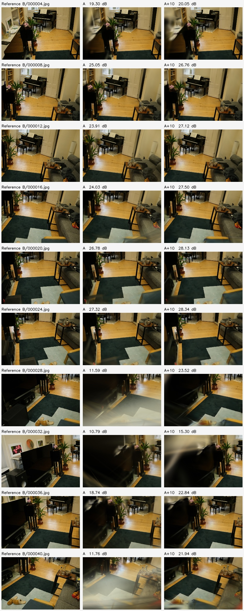

# 보완 이미지 추가 효과 PoC — 2026-11-13

**판정: 저장된 실사 `room` 장면에서 보완 이미지 10장을 추가하면, 보완 구간의 학습 제외 시점 재현 품질이 개선됐다. 실제 사람이 안내에 따라 재촬영하는 효과는 미측정이다.**

기존 상태 점검은 정합 수 증가만 확인했다. 이번에는 A와 A+10을 같은 평가 사진으로 비교하도록 구성하고, 실제 Brush 학습 4회와 평가 렌더 40장을 새로 생성했다. 과거 시점 선택 알고리즘의 튜닝이나 재평가는 하지 않았다.

## 실측 결과

PSNR은 시점별 RGB PSNR의 산술평균이며 SSIM은 RGB 채널 평균, Gaussian 11×11·sigma 1.5·테두리 5픽셀 제외 방식이다. 원본과 렌더의 픽셀 크기가 일치하는지 확인하고 리사이즈 없이 계산했다.

| 시드 | A PSNR | A+10 PSNR | 차이 | A SSIM | A+10 SSIM | PSNR 개선 시점 |
| --- | ---: | ---: | ---: | ---: | ---: | ---: |
| 42 | 19.927dB | 24.150dB | +4.223dB | 0.71324 | 0.80858 | 10/10 |
| 7 | 19.401dB | 24.142dB | +4.740dB | 0.68423 | 0.80832 | 10/10 |
| 두 시드 평균 | 19.664dB | 24.146dB | +4.482dB | 0.69874 | 0.80845 | 각 10/10 |

시드별 SSIM 차이는 +0.09534 / +0.12409였다. 두 시드 모두 10개 시점의 SSIM이 증가했다. 동일한 평가 사진을 두 번 사용한 반복이며 독립 장면 20개로 세지 않는다.

대응 이미지에서는 B/000028·000040의 TV 앞 바닥·러그 주변에 있던 큰 번짐이 줄었다. B/000032의 벽·TV 주변은 보완 후에도 많이 흐리며, 첫 평가 시점의 왼쪽 가구도 충분히 복원되지 않았다. 전체 화면 평균의 개선이 모든 물체·픽셀의 개선을 뜻하지 않는다. ROI를 사전 지정한 시험은 아니므로 이 관찰을 ROI 성공률로 집계하지 않았다.

아래는 시드 42의 **평가 시점 전체 10개**다. 왼쪽은 평가 원본, 가운데는 A, 오른쪽은 A+10이다. 두 시드의 전체 화면을 열어 확인했다.



## 고정한 조건

- 입력은 기존 공개 Mip-NeRF 360 `room` 실사 이미지로부터 만든 저장 데이터다. 직접 촬영한 스마트폰 영상은 아니다. 원본 출처와 다운로드 검증은 [핵심 PoC](core-poc-result.md)에 있다.
- A 학습 60장과 A+10 학습 70장. 추가 10장은 과거에 균등 선택해 둔 B 이미지이며, 이번 결과를 보고 다시 고르지 않았다. 평가 10장은 B 구간의 매 4번째 사진으로 두 조건의 학습 이미지에서 제외했다.
- 공통 A·평가 이미지의 SHA256과 카메라 자세, 카메라 내부 파라미터, 초기 점군 파일이 동일함을 검사했다. 초기 점군은 저장된 A 기반 7,577점이며 두 조건 모두 같은 파일을 복사했다.
- 같은 Brush 0.3.0 실행 파일, 3,000스텝, 최대 해상도 960, 최대 splat 300,000, 시드 42·7을 사용했다. 같은 시드끼리 대응 비교하고 4회를 순차 실행했다. 실제 평가 이미지 크기는 958×638이다.
- 평가 사진을 정확히 10장씩 분리하기 위해 A의 평가 주기는 7, A+10의 평가 주기는 8이다. 정렬된 입력 슬롯을 재배치해 각각 60/10과 70/10으로 나눴다. 생성된 평가 파일 집합이 사전 지정한 슬롯 집합과 일치하는지도 검사했다.
- 최종 출력 PLY의 Gaussian 수는 A 19,109 / 19,000, A+10 18,959 / 18,939였다. 점·Gaussian 수 증가를 품질 개선의 지표로 사용하지 않았다.

각 실행은 학습·내보내기·평가를 포함해 76.426 / 74.619 / 74.365 / 75.311초였다. 총 약 301초다. PLY 4개 모두 종료 코드 0, Gaussian float 속성 59개, vertex 수에 맞는 payload 길이와 전체 float의 유한성을 확인했다. 표본 단일 프로세스 최대 RSS는 약 343MiB이고 관측한 memory pressure는 정상(1)이었다. GPU·시스템 전체 메모리 수치가 아니며, 실행 전부터 swap이 사용 중이어서 swap 0을 주장하지 않는다.

## 해석 범위

**이 한 장면의 보완 구간에서는 추가 관측이 렌더 품질에 도움이 됐다는 기술적 근거를 확보했다.** 다음 한계를 포함하는 오프라인 조건의 결과다.

1. 모든 100장으로 구한 저장 SfM 자세·내부 파라미터를 공통으로 사용했다. A만으로 정합되지 않던 카메라까지 알고 있는 조건이며, 평가 사진도 자세 추정에 참여했다. 평가 사진을 3DGS 학습에서만 제외했다. 새 SfM 실행이나 실제 A→A+B 전체 처리의 효과 측정은 아니다.
2. 평가 사진은 추가 B 사진과 가까운 촬영 구간이다. 그 구간의 개선을 측정하며, 초기 A 구간의 화질 유지나 독립 촬영 영상·미관측 공간 전체의 완성도를 검증하지 않는다. 기존 A 평가 PSNR 29.94dB와 평가 시점이 달라 직접 비교할 수 없다.
3. 보완량 자체가 다르다(60장 대 70장). “추가 사진이 도움이 되는가”의 비교이고, 같은 예산에서 안내 촬영이 자유 촬영보다 좋은지를 검증하지 않는다. 안내·자유 촬영 비교는 [실제 촬영 절차](../capture-support-validation.md)가 필요하다.
4. 장면 1개와 최적화 시드 2개다. 통계적 일반화, 안내 사용성, 이동 가능성, 실기기 P0/P1 완료로 확장하지 않는다.

## 증거·재현

- [수치·프로토콜·실행 명령·해시·PLY 검사](supplement-effect-check.json)
- [실행 코드](../../../poc/check_supplement_effect.py), [분할·평가 계산 테스트](../../../poc/tests/test_supplement_effect.py)
- 로컬 원본: `poc/data/supplement-effect-gpu/`의 `manifest.json`, `protocol.json`, `comparison.json`, `datasets/`, `runs/`, 두 시드의 비교 JPG. 무거운 입력·PLY·원본 렌더는 Git 제외다.
- 최초 샌드박스 실행은 Metal adapter를 찾지 못해 실패했다. `poc/data/supplement-effect/`에 실패 로그를 보존했고, GPU 접근 권한으로 새 출력 경로에서 4회를 성공했다.
- 자동 테스트 23개 통과. 평가 분할의 중복·누수 거부와 알려진 오차의 PSNR/SSIM 계산을 포함한다. `git diff --check` 통과.

저장 입력과 Brush가 있는 환경에서, 사이드 프로젝트 루트(`side-projects/macos-ios-poc/`)에서 실행한다. 기존 결과는 덮어쓰지 않는다.

```sh
poc/.venv/bin/python poc/check_supplement_effect.py --output poc/data/supplement-effect-new
poc/.venv/bin/python -m unittest discover -s poc -p 'test_*.py'
```
